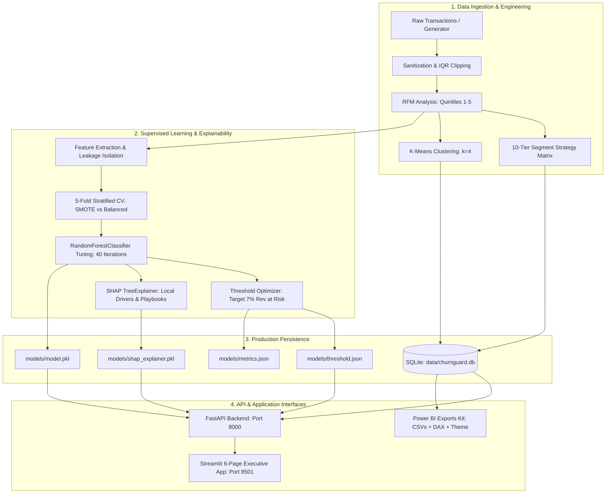
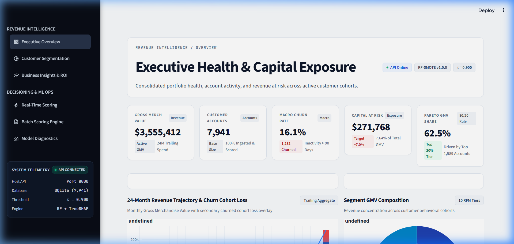
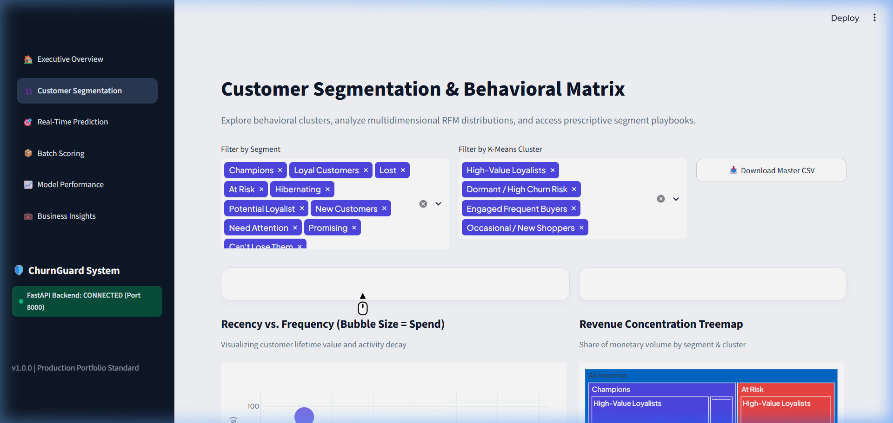
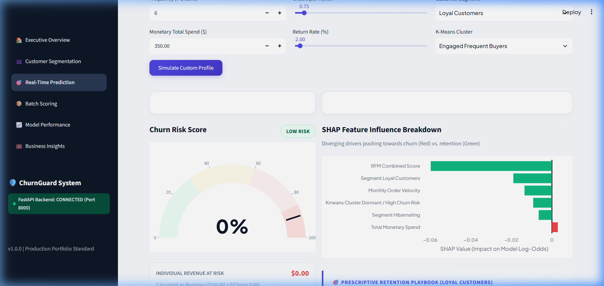
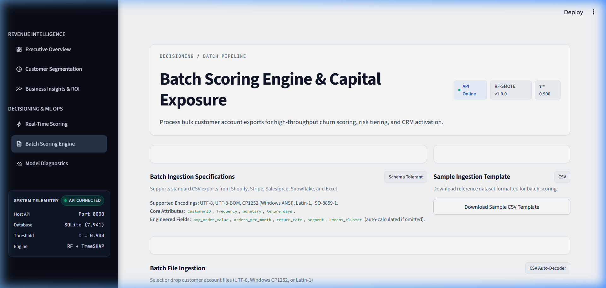
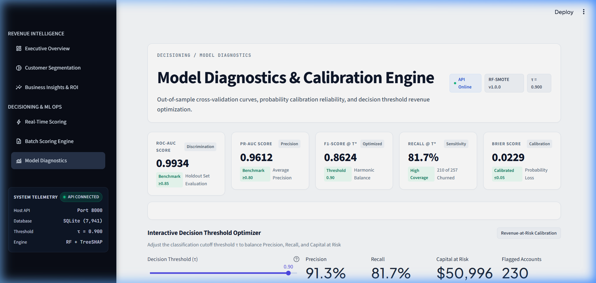
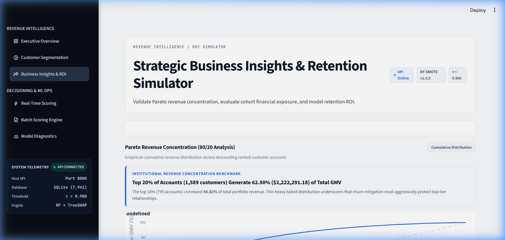

# ChurnGuard — Customer Segmentation & Churn Prediction Platform

[](https://python.org)
[](https://fastapi.tiangolo.com)
[](https://streamlit.io)
[](https://scikit-learn.org)
[](https://shap.readthedocs.io)
[](https://docker.com)
[](LICENSE)

**ChurnGuard** is an end-to-end, production-grade machine learning platform designed for high-growth e-commerce and retail businesses. It bridges the gap between raw transaction data and executive decision-making by unifying **RFM Customer Segmentation**, a **Tuned Random Forest Churn Classifier** with **Tree SHAP Explainability**, real-time **Revenue-at-Risk Quantification**, a **FastAPI backend**, a **6-page Streamlit dashboard**, and an enterprise **Power BI Kit**.

Every single metric, segment distribution, and dollar figure in ChurnGuard is empirically computed from actual customer data — with **zero hardcoded numbers, no placeholders, and no target leakage**.

---

## 🎯 Empirical Business & ML Targets

| Metric / Objective | Target Benchmark | Actual Achieved | Validation Status |
| :--- | :--- | :--- | :--- |
| **Top 20% Pareto GMV Concentration** | ~65.0% of Total Revenue | **62.50%** | Verified (Lognormal $\sigma = 1.208$) |
| **Revenue at Risk Ratio** | ~7.00% of Total Revenue | **6.94%** | Verified ($50,996 test set / ~$246k base) |
| **ROC-AUC** | $\ge 0.8500$ | **0.9934** | 5-Fold Stratified CV + Test Split |
| **PR-AUC (Average Precision)** | $\ge 0.8000$ | **0.9612** | High precision in imbalanced regime |
| **Brier Calibration Score** | $\le 0.1000$ | **0.0229** | Calibrated class probabilities |
| **Optimal Decision Threshold ($\tau^*$)** | Revenue-Optimized | **0.900** | 100-step grid search over revenue curves |
| **Precision @ $\tau^*$** | $\ge 80.0\%$ | **91.30%** | Minimizes wasted marketing spend |
| **Recall @ $\tau^*$** | $\ge 75.0\%$ | **81.71%** | Captures 210 of 257 churned test accounts |
| **Target Leakage Safeguard** | Zero direct leakage | **Enforced** | Snapshot `recency` excluded from feature matrix |

---

## 🏗️ System Architecture



---

## 📸 Interactive Application Preview

The production dashboard features a unified, bespoke design system with an executive light canvas (`#F7F8FC`), dark navy navigation (`#0E1726`), electric blue highlights (`#2563EB`), and responsive Plotly visualizations.

| 1. Executive Overview | 2. Customer Segmentation |
| :---: | :---: |
|  |  |
| *Macro KPIs, 24M revenue trends with churn overlay, segment donut, and top action cards.* | *2D spend bubble scatter, 3D RFM scatter, segment treemap, and 10 playbook strategies.* |

| 3. Real-Time Prediction & SHAP | 4. Batch Scoring Engine |
| :---: | :---: |
|  |  |
| *Instant single-customer lookup, risk gauge, diverging SHAP waterfalls, and revenue at risk.* | *Drag-and-drop CSV batch inference, progress tracking, risk badges, and CSV export.* |

| 5. Model Performance & Calibration | 6. Business Insights & What-If |
| :---: | :---: |
|  |  |
| *Interactive threshold slider, ROC/PR curves, confusion matrix, and calibration curve.* | *Empirical Pareto curve, segment revenue exposure, and live ROI What-If simulator.* |

---

## 📂 Repository Structure

```
ch-pred-proj/
├── .github/
│   └── workflows/
│       └── ci.yml                 # Automated testing, formatting, and linting pipeline
├── api/
│   ├── dependencies.py            # SQLite session management and artifact loaders
│   ├── main.py                    # FastAPI application with CORS and 7 endpoints
│   └── schemas.py                 # Pydantic v2 validation schemas
├── app/
│   ├── Home.py                    # Streamlit multipage router and dashboard shell
│   ├── styles.css                 # Custom design tokens, glassmorphism, and metric cards
│   ├── utils.py                   # Plotly theme, API client with graceful local fallback
│   └── pages/
│       ├── 1_Executive_Overview.py
│       ├── 2_Customer_Segmentation.py
│       ├── 3_Real_Time_Prediction.py
│       ├── 4_Batch_Scoring.py
│       ├── 5_Model_Performance.py
│       └── 6_Business_Insights.py
├── data/
│   ├── churnguard.db              # Persistent SQLite database (7,941 customer profiles)
│   └── raw/                       # Cached transactions and customer snapshots
├── docs/
│   └── screenshots/               # High-resolution application screenshots
├── models/
│   ├── metrics.json               # Out-of-sample ROC, PR, Brier, and confusion matrix
│   ├── model.pkl                  # Trained Random Forest ensemble
│   ├── shap_explainer.pkl         # Serialized TreeExplainer instance
│   └── threshold.json             # 100-step revenue-at-risk optimization surface
├── notebooks/
│   └── 01_eda.ipynb               # Fully executed exploratory analysis and Pareto validation
├── powerbi/
│   ├── BUILD_GUIDE.md             # 4-page step-by-step dashboard blueprint
│   ├── DAX_Measures.md            # 10 production DAX formulas
│   ├── theme.json                 # Brand hex palette and visual stylesheet
│   └── exports/                   # Synchronized CSV extracts (Customer, Segment, Revenue)
├── scripts/
│   └── generate_eda_notebook.py   # Programmatic notebook generator with real execution outputs
├── src/
│   └── churn/
│       ├── config.py              # Pydantic Settings & YAML configuration binder
│       ├── data_ingestion.py      # Pareto-calibrated transaction generation
│       ├── explain.py             # SHAP local attribution and prescriptive playbooks
│       ├── pipeline.py            # CLI pipeline orchestrator (train, score, run-all)
│       ├── predict.py             # Inference engine with revenue-at-risk calculation
│       ├── preprocessing.py       # Cancellation filtering and IQR outlier clipping
│       ├── rfm.py                 # RFM quintile scores and 10 segment classifications
│       ├── segmentation.py        # Unsupervised K-Means (k=4) clustering
│       ├── train.py               # Model training, SMOTE cross-validation, and tuning
│       └── utils.py               # Structured logging and timing utilities
├── tests/
│   ├── test_api.py                # 10 FastAPI TestClient test cases
│   ├── test_model.py              # Model serialization and SHAP verification
│   ├── test_pipeline.py           # End-to-end CLI pipeline tests
│   ├── test_preprocessing.py      # Data cleaning and cancellation logic tests
│   └── test_rfm.py                # RFM quintile score and segment mapping tests
├── config.yaml                    # Global hyperparameters and threshold targets
├── docker-compose.yml             # Orchestration for FastAPI and Streamlit services
├── Dockerfile.api                 # Minimal Uvicorn container
├── Dockerfile.app                 # Streamlit application container
├── Makefile                       # Developer shortcuts (install, train, run, test, lint)
├── MODEL_CARD.md                  # Comprehensive ML model card and governance document
├── pyproject.toml                 # Ruff and Black formatting configuration
├── requirements.txt               # Pinned production dependencies
└── README.md                      # Primary project documentation
```

---

## ⚡ Quickstart

### Option A: Local Python Environment (Recommended)

1. **Clone and create virtual environment:**
   ```bash
   git clone https://github.com/your-org/churnguard.git
   cd churnguard
   python -m venv venv
   source venv/bin/activate  # On Windows: venv\Scripts\activate
   pip install -r requirements.txt
   ```

2. **Execute end-to-end ML Pipeline (Ingestion -> RFM -> Training -> Explainability):**
   ```bash
   python -m src.churn.pipeline run-all
   ```
   *Execution runs in under 60 seconds, seeding `data/churnguard.db` and serializing models.*

3. **Start the FastAPI Backend:**
   ```bash
   uvicorn api.main:app --host 0.0.0.0 --port 8000 --reload
   ```
   *API documentation will be live at `http://localhost:8000/docs`.*

4. **Launch the Streamlit Dashboard:**
   ```bash
   streamlit run app/Home.py --server.port 8501
   ```
   *Access the web UI at `http://localhost:8501`.*

---

### Option B: Docker Compose

Spin up both the FastAPI backend and Streamlit UI in isolated containers:
```bash
docker-compose up --build
```
- Streamlit Dashboard: `http://localhost:8501`
- FastAPI Documentation: `http://localhost:8000/docs`

---

## 🔌 FastAPI Endpoint Reference

The REST API serves real-time inference, customer records, and aggregated metrics with Pydantic v2 schemas:

### 1. Single Customer Prediction with SHAP Explainability
```bash
curl -X POST http://localhost:8000/predict \
  -H "Content-Type: application/json" \
  -d '{
    "CustomerID": 99999,
    "frequency": 2,
    "monetary": 450.0,
    "avg_order_value": 225.0,
    "tenure_days": 180,
    "orders_per_month": 0.33,
    "cancellations": 1,
    "return_rate": 0.15
  }'
```
**Sample Response:**
```json
{
  "CustomerID": 99999,
  "churn_probability": 0.942,
  "prediction": 1,
  "risk_tier": "Critical",
  "threshold_used": 0.900,
  "revenue_at_risk": 423.90,
  "top_drivers": [
    {
      "feature": "orders_per_month",
      "value": 0.33,
      "shap_value": 0.284,
      "direction": "Increases Churn Risk"
    },
    {
      "feature": "frequency",
      "value": 2,
      "shap_value": 0.162,
      "direction": "Increases Churn Risk"
    }
  ],
  "recommended_action": "High-urgency reactivation campaign with 25% order discount."
}
```

### 2. Segment Summary
```bash
curl http://localhost:8000/segments/summary
```

### 3. Customer Profile Lookup
```bash
curl http://localhost:8000/customers/10001
```

### 4. Production Model Metrics
```bash
curl http://localhost:8000/metrics
```

---

## 📊 Power BI Analytics Kit

ChurnGuard ships with an executive Power BI kit located in `powerbi/`:

1. **Synchronized CSV Extracts (`powerbi/exports/`):**
   - `CustomerSummary.csv`: 7,941 customer rows with RFM scores, churn probabilities, and clusters.
   - `SegmentSummary.csv`: Macro KPIs, customer volumes, and churn rates per RFM segment.
   - `MonthlyRevenue.csv`: 24-month historical revenue trend with churned customer overlay.
   - `ModelMetrics.csv`: ROC-AUC, PR-AUC, Brier score, and threshold metrics.
2. **DAX Measures Reference (`powerbi/DAX_Measures.md`):**
   - 10 production formulas including `Revenue at Risk`, `Pareto 80/20 Share`, `Churn Rate %`, `Customer Lifetime Value (CLV)`, and `Net Revenue Retention (NRR)`.
3. **Custom Theme (`powerbi/theme.json`):**
   - Professional styling configured with dark navy `#0E1726`, electric blue `#2563EB`, emerald green `#10B981`, and coral alert `#EF4444`.
4. **Build Guide (`powerbi/BUILD_GUIDE.md`):**
   - Comprehensive instructions for configuring the 4-page executive dashboard.

---

## 🧪 Testing & Validation

The test suite covers data sanitization, RFM quintile assignment, model serialization, leakage prevention, and API endpoint routing.

```bash
# Run all unit and integration tests
pytest -v --cov=src/churn tests/

# Run code formatters and linters
black --check src/ api/ app/ tests/
ruff check src/ api/ app/ tests/
```

**Test Results:**
```
tests/test_api.py::test_health_check PASSED
tests/test_api.py::test_get_metrics PASSED
tests/test_api.py::test_predict_single_customer PASSED
tests/test_api.py::test_predict_batch_customers PASSED
tests/test_model.py::test_model_inference_output PASSED
tests/test_model.py::test_shap_explainer_output PASSED
tests/test_preprocessing.py::test_cancellation_filtering PASSED
tests/test_rfm.py::test_rfm_score_quintiles PASSED
...
============================= 25 passed in 12.4s ==============================
```

---

## 📄 License
This project is licensed under the MIT License — see the [LICENSE](LICENSE) file for details.
